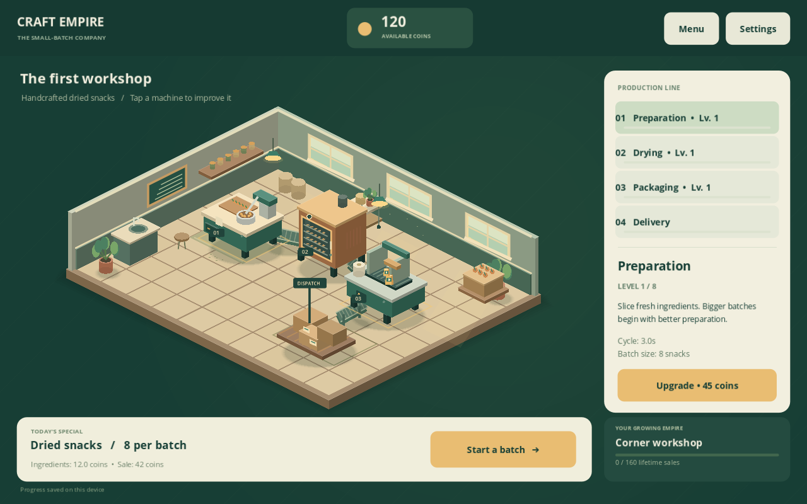

# Craft Empire Tycoon

Grywalny pierwszy etap gry w **Godot 4.7.2 Stable / GDScript**. Prowadzisz niewielki warsztat produkujący suszone przekąski: przygotowanie → suszenie → pakowanie → dostawa. Sprzedaż finansuje ulepszenia i rozwój firmy.



## Uruchomienie na komputerze

1. Zainstaluj standardowy **Godot 4.7.2 Stable** (wersja bez .NET).
2. Pobierz lub sklonuj ten projekt i w Godot wybierz **Import**, wskazując `project.godot`.
3. Poczekaj na import zasobów. Naciśnij **F5**.
4. Wybierz **Open your workshop**, a następnie **Start a batch**.

Projekt nie wymaga Node.js, płatnych usług, konta użytkownika ani kluczy API. Na komputerze z silnikiem w PATH można także użyć:

```sh
godot --path . --editor --import
godot --path .
```

Gra zaczyna w języku angielskim. W **Settings → Language: English / Polski** możesz przełączyć ją na polski. Język, dźwięki i ograniczenie animacji są zapisywane wraz z warsztatem.

## Jak grać

- Zaczynasz ze **120 monetami**. Składniki do jednej partii kosztują **12**, a pierwsza sprzedaż daje **42** monety, czyli **30** zysku.
- Jedna partia przechodzi przez całą linię w około **13 sekund**. Paski pokazują pracę stanowisk, a produkty przemieszczają się po przenośnikach.
- Dotknij maszyny lub wybierz ją na liście. **Upgrade** kupuje następny poziom.
- Przygotowanie zwiększa wielkość i wartość partii; suszenie skraca proces; pakowanie zwiększa cenę sprzedaży. Wszystkie trzy ulepszenia skracają czas odpowiedniego stanowiska.
- Ulepszenia wpływają na **następną** partię. Aktualna zachowuje swoje parametry.
- Po zakupie ulepszenia musi zostać dość monet na składniki. Maszyny mają osiem poziomów.
- Dostawa sprzedaje gotową partię automatycznie. Kolejną uruchamiasz samodzielnie.
- Łączna wartość sprzedaży odblokowuje cztery rangi firmy.
- **Menu** i **Esc** wracają do menu; **Continue workshop** wznawia grę. **New game** wymaga potwierdzenia, gdy istnieje zapis.

Zapis jest lokalny, bez rozwoju offline: produkcja zatrzymuje się w menu i po uśpieniu aplikacji. Otwarte ustawienia w warsztacie nie zatrzymują produkcji. Autosave działa co 10 sekund, przy zmianie etapu, zakupie, nowej grze, powrocie do menu, zamknięciu i uśpieniu aplikacji.

## Struktura projektu

| Ścieżka | Rola |
| --- | --- |
| `project.godot`, `scenes/main.tscn` | Konfiguracja silnika i scena startowa |
| `scenes/factory.tscn`, `scenes/station.tscn` | Warsztat i instancje maszyn |
| `scripts/gameplay/game.gd` | Stan gry, przepływ produkcji, sygnały i autosave |
| `scripts/gameplay/economy.gd` | Oddzielne obliczenia ekonomii |
| `config/balance.json` | Wszystkie ceny, czasy, poziomy i progi rozwoju |
| `scripts/gameplay/save_store.gd` | Zapis atomowy, walidacja danych i kopia zapasowa |
| `scripts/art/` | Oryginalna grafika wektorowa, izometria i animacje |
| `scripts/ui/` | Menu, warsztat, ustawienia, motyw i syntezowane dźwięki |
| `assets/strings.csv` | Teksty i tłumaczenia EN/PL; importowane przez Godot |
| `scripts/tests/` | Testy rozgrywki, zapisu i interfejsu |
| `docs/` | Roadmapa, wyniki walidacji i obrazy z uruchomionej gry |

Zapis `user://workshop.json` ma wersjonowany format i kopię `.bak`. Uszkodzony lub niezgodny zapis podstawowy jest odczytywany z ostatniej poprawnej kopii. Typowa lokalizacja na Windows to `%APPDATA%/Godot/app_userdata/Craft Empire Tycoon/`, a na Linux `~/.local/share/godot/app_userdata/Craft Empire Tycoon/`. W chmurze dane trafiają do `/workspace/.data/craft/godot/app_userdata/Craft Empire Tycoon/`.

## Środowisko chmurowe

Istniejący checkout jest już izolowany; nie twórz dodatkowego worktree do zwykłej pracy nad projektem.

```sh
cd /workspace/first-project
./scripts/setup.sh
./scripts/test.sh
./scripts/run.sh --headless --quit-after 120
```

`setup.sh` instaluje przypięty silnik poza repozytorium w `/workspace/tools/craft-godot`, sprawdza oficjalną sumę SHA-512 i importuje projekt. Powtórne uruchomienie wykorzystuje zainstalowany silnik. `env.sh` ustawia zapisywalne katalogi XDG. Skrypty nie zmieniają kodu ani plików konfiguracyjnych gry podczas instalacji.

Do uruchomienia obrazu potrzebny jest serwer graficzny. Jeśli jest dostępny, użyj `./scripts/run.sh` lub `./scripts/run.sh --editor`. Tryb headless wykonuje logikę i testy, ale nie wyświetla gry ani nie odtwarza dźwięku.

## Testy

Po imporcie projektu, także na lokalnym komputerze:

```sh
godot --headless --path . --script res://scripts/tests/gameplay_test.gd
```

**Uwaga:** ten test wywołuje New Game. W chmurze używaj `./scripts/test.sh`, który automatycznie izoluje pliki zapisu w katalogu tymczasowym. Lokalnie uruchamiaj test w osobnym profilu danych albo po wykonaniu kopii swojego zapisu.

Test z prawdziwym renderowaniem i symulowanym wejściem myszy wymaga wyświetlacza oraz osobnego profilu danych:

```sh
XDG_DATA_HOME=/tmp/craft-visual-test ./scripts/run.sh --audio-driver Dummy \
  --script res://scripts/tests/visual_test.gd
```

Obrazy trafiają domyślnie do `/tmp`; zmienna `CRAFT_CAPTURE_DIR` może wskazać inny istniejący katalog. Wyniki i zakres walidacji: [docs/VALIDATION.md](docs/VALIDATION.md).

## Zakres i dalsza praca

To jeden kompletny, mały warsztat, jeden produkt i ręczne uruchamianie partii. Brak reklam, płatności, SDK, serwera, premium waluty oraz mechanik pay-to-win. Architektura sygnałów i oddzielna ekonomia umożliwiają późniejsze rozbudowanie gry bez uzależniania obecnego prototypu od usług zewnętrznych.

Układ jest poziomy i skaluje się do ekranu. Obsługiwane są mysz i dotyk. Renderowanie GL Compatibility, lokalne fonty i grafika 2D ograniczają wymagania sprzętowe. **Nie wykonano testów na urządzeniu Android ani eksportu APK/Windows EXE**; potrzebne będą szablony eksportu 4.7.2, konfiguracja Android SDK/JDK, podpisywanie i walidacja na sprzęcie. Zmiany rozmiaru okna nie zastępują testów urządzenia.

Kolejny etap: [roadmapa](docs/ROADMAP.md).

Grafika i krótkie efekty dźwiękowe zostały stworzone dla tego projektu. Font Open Sans jest używany na licencji Apache 2.0; informacje i pełny tekst licencji są w `assets/FONT-LICENSE*.txt`.
