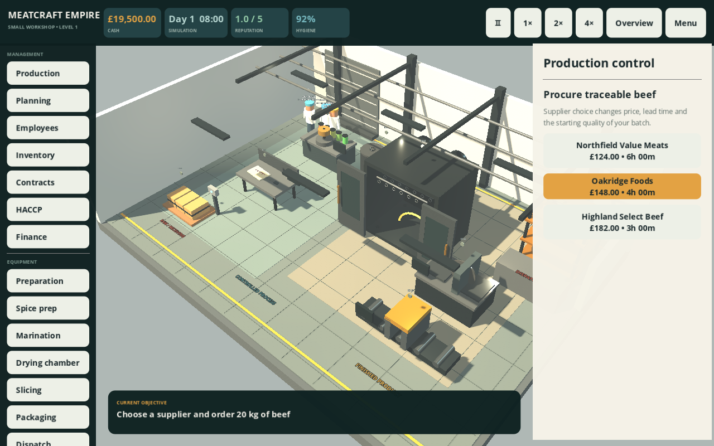

# MeatCraft Empire 3D

Grywalny prototyp tycoona fabryki biltongu zbudowany w **Godot 4.7.2 Stable / GDScript**. Kupujesz pierwszą halę, uruchamiasz markę MeatCraft, zamawiasz identyfikowalną wołowinę i prowadzisz partię przez przygotowanie, przyprawianie, marynowanie, zawieszanie, siedmiodniowe suszenie, krojenie, pakowanie i wysyłkę.



## Jak uruchomić na Windows

1. Pobierz standardowy **Godot 4.7.2 Stable** dla Windows, bez wersji .NET.
2. Rozpakuj projekt do zwykłego folderu, najlepiej poza OneDrive. Nie otwieraj pliku ZIP bezpośrednio w Godot.
3. W Menedżerze projektów kliknij **Importowanie**, wskaż plik `project.godot` i kliknij **Importuj i edytuj**.
4. Po otwarciu edytora kliknij trójkąt **Uruchom projekt** w prawym górnym rogu albo naciśnij **F5**.

Jeżeli projekt jest już otwarty tak jak na ekranie użytkownika, wystarczy kliknąć trójkąt **▶** w prawym górnym rogu. Pierwszy import może potrwać kilkanaście sekund.

## Pierwsza rozgrywka

1. Wybierz **Start a new company**.
2. Kup **Small Workshop** za £12,000.
3. Wybierz działalność **MeatCraft**.
4. Zainstaluj linię startową za £16,500.
5. Zamów 20 kg wołowiny. Prędkość `4×` skraca oczekiwanie.
6. Rozpocznij partię 10 kg jednej z trzech receptur.
7. W połowie suszenia wykonaj obowiązkową kontrolę.
8. Przyjmij kontrakt w panelu **Contracts** albo sprzedaj na rynku otwartym.
9. Po zapakowaniu wyślij gotowe opakowania, aby uzyskać przychód.

Linia startowa obejmuje trzyosobową załogę. W panelu **Employees** można zatrudniać, przydzielać i zwalniać pracowników oraz śledzić płace, zmęczenie i zadania. Awaria zatrzymuje właściwy etap do czasu przydzielenia technika, a incydent jakości blokuje partię do wykonania działania korygującego.

Sterowanie kamerą: przeciągnięcie myszy lub palca przesuwa widok, rolka lub gest szczypania zmienia przybliżenie, a `Q/E` obraca kamerę. Kliknięcie urządzenia otwiera jego panel. Interfejs działa po angielsku i po polsku; język zmienia się w **Settings**.

## Zaimplementowane systemy

- proceduralna scena 3D hali z oświetleniem, strefami higienicznymi, instalacjami, bramą, linią maszyn i widoczną załogą poruszającą się do rzeczywistych zadań;
- wybór nieruchomości i działalności, zakup kompletnej linii startowej;
- trzy dostawy różniące się ceną, czasem i jakością, numery partii dostawcy oraz magazyn;
- trzy receptury: Coriander, Chilli i BBQ, ze spójnymi deklaracjami cukru i alergenów;
- pełna sekwencja produkcji z animowanym suszeniem, 21 paskami mięsa, kontrolą w 3,5. dniu i bilansem masy;
- zatrudnianie i zwalnianie, cztery role, ograniczona liczba etatów, przydziały, autorytatywne zadania, doświadczenie, zmęczenie, morale i płace naliczane według okresów czasu gry;
- stan każdej maszyny, zużycie, godziny pracy, awarie, części zamienne, przestoje, odpłatne naprawy technika i historia serwisowa;
- incydenty jakości, kwarantanna aktywnych i gotowych partii, działania korygujące, zwolnienie partii oraz trwała historia identyfikowalności;
- trzy kontrakty klientów z terminami; przychód jest naliczany dopiero po prawidłowej wysyłce wymaganej liczby opakowań;
- opakowania 50 g, zapasy materiałów, wysyłka, księga przychodów i wydatków, płace, reputacja i konserwacja;
- pauza i prędkości `1×`, `2×`, `4×`, autosave oraz zapis v3 z migracją zapisu v2;
- zewnętrzna lokalizacja EN/PL i układ poziomy od 960×540.

Wartości procesu są fikcyjnym balansem gry. Projekt nie jest instrukcją produkcji żywności ani prawnie wystarczającym systemem HACCP.

## Struktura

| Ścieżka | Rola |
| --- | --- |
| `scenes/meatcraft_main.tscn` | Główna scena 3D |
| `scripts/meatcraft/factory_3d.gd` | Proceduralna hala, maszyny, pracownicy i mięso |
| `scripts/meatcraft/factory_camera.gd` | Kamera myszy i dotyku oraz wybór urządzeń |
| `scripts/meatcraft/meat_game.gd` | Stan ekonomii, magazynu, procesu i zapisu |
| `scripts/meatcraft/workforce_system.gd` | Pracownicy, zadania, doświadczenie i płace |
| `scripts/meatcraft/machine_system.gd` | Zużycie, awarie, części i naprawy maszyn |
| `scripts/meatcraft/quality_system.gd` | Incydenty, kwarantanna i historia partii |
| `scripts/meatcraft/contract_system.gd` | Kontrakty, terminy i rozliczanie wysyłek |
| `scripts/meatcraft/meatcraft_ui.gd` | Menu, HUD, panele zarządzania, tutorial i lokalizacja |
| `config/meatcraft_game.json` | Dane ekonomii, receptur, dostawców i czasów |
| `assets/meatcraft_strings.csv` | Tłumaczenia EN/PL |
| `scripts/tests/` | Testy starego prototypu, nowej symulacji i renderowania |
| `docs/screenshots/` | Rzeczywiste zrzuty z uruchomionej gry |

Poprzedni prototyp 2D pozostaje w historii Git i w starszych scenach jako punkt odniesienia. Główna scena projektu uruchamia wersję MeatCraft 3D.

## Zapis gry

Aktualny zapis v3 znajduje się w `user://meatcraft_v3.json` i ma kopię `.bak`. Typowa lokalizacja w Windows to `%APPDATA%\Godot\app_userdata\MeatCraft Empire\`. Przy pierwszym uruchomieniu starszy zapis v2 jest wczytywany, migrowany i zapisywany jako osobny plik v3; oryginał v2 pozostaje bez zmian. Autosave działa co około 12 sekund oraz po ważnych działaniach. Zapis obejmuje pracowników i płace, zadania, maszyny i aktywne naprawy, incydenty jakości, kontrakty, historię partii, finanse oraz dotychczasowy stan produkcji.

## Środowisko chmurowe i testy

```sh
cd /workspace/first-project
./scripts/setup.sh
./scripts/test.sh
./scripts/run.sh
```

`setup.sh` instaluje przypięty Godot 4.7.2 poza repozytorium, sprawdza oficjalną sumę SHA-512 i importuje projekt. `test.sh` uruchamia 43 testy regresji starego prototypu, 41 testów podstawowej symulacji MeatCraft oraz 61 testów systemów operacyjnych w odizolowanym profilu danych.

Test z prawdziwym renderowaniem wymaga serwera graficznego:

```sh
source scripts/env.sh
CRAFT_CAPTURE_DIR="$PWD/docs/screenshots" \
  "$CRAFT_GODOT" --path "$PWD" --audio-driver Dummy \
  --script res://scripts/tests/meatcraft_visual_test.gd
```

Szczegółowe wyniki są w [dokumencie walidacji](docs/VALIDATION.md). Aktualny stan i następne zadania opisują [checkpoint](docs/AUTONOMOUS_DEV_CHECKPOINT.md) oraz [plan następnej sesji](docs/NEXT_SESSION.md).

## Zakres eksportów

Projekt używa renderera Compatibility i nie zależy od płatnych usług, kont ani kluczy API. W tej iteracji nie utworzono plików EXE, APK ani HTML5, ponieważ w środowisku nie ma szablonów eksportu Godot 4.7.2 ani Android SDK. Instrukcje dalszej walidacji są w [roadmapie](docs/ROADMAP.md).

Modele i grafika fabryki są oryginalne i tworzone proceduralnie w projekcie. Open Sans jest używany na licencji Apache 2.0; informacje licencyjne znajdują się w `assets/FONT-LICENSE*.txt`.
